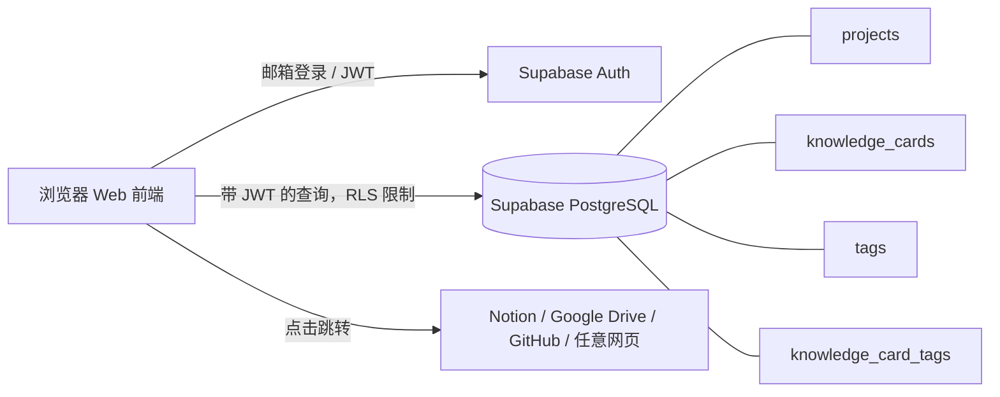

# Personal Garden · 产品需求文档（PRD）

- **版本**：v0.2（待复审）
- **日期**：2026-11-25
- **技术基线**：Supabase PostgreSQL（数据库）+ Supabase Auth（认证）
- **来源**：由 `01.md`（定位与信息架构）合并整理；视觉部分见 `DESIGN.md`

---

## 1. 产品定位

**Personal Garden — 个人知识与探索入口。**

它不负责生产和存储大量内容，而是负责**组织、连接和呈现**这些内容。整个体系分三层：

| 层 | 职责 | 说明 |
| --- | --- | --- |
| Personal Garden（本产品） | 知识导航、项目组织、资源索引、探索入口 | 负责内容之间的**组织关系** |
| Notion | 文字笔记、阅读记录、思考、知识整理 | 负责**内容本身**，是唯一的信息收录与正文编辑口 |
| Google Drive | PDF、论文、图片、视频及其他附件 | 负责**文件本身** |

**重要边界：网站不是收录入口。** 新增内容、写笔记、上传文件都在 Notion / Drive 完成；网站里的「知识卡片」只是对已存在外部资料的一条**索引入口**（标题、链接、类型、项目关联、标签），不承载正文。卡片的新增和编辑 = 维护索引关系，不是收录信息。一张知识卡片可同时关联多个项目；各项目引用同一张卡片，不复制卡片记录。

两个外部平台继续保持原有使用习惯。不重复建设笔记编辑器，不重新发明网盘，第一版不嵌入 Notion 页面或 PDF 阅读器，直接跳转原始资源更稳定。

> 网站的私人访问权限与外部资源的访问权限是两回事。Notion / Drive 的资源仍由各自平台控制，不要因为网站需要跳转就把所有文件改为公开。

---

## 2. 目标用户与核心场景

单一用户（站点所有者），登录后使用。

| 场景 | 用户行为 | 产品响应 |
| --- | --- | --- |
| S1 登记索引 | 在 Notion 写完笔记、Drive 放好 PDF 后，回来登记这条资料 | 新增一张索引卡片，填标题 + 链接，选填描述、项目、标签 |
| S2 找回资料 | 忘记某份资料放在哪个项目 | 在 Library 按标题搜索、按类型/项目/标签筛选 |
| S3 浏览主题 | 想继续某个方向的探索 | 从首页或 Projects 进入项目详情，看该主题下的卡片列表 |
| S4 调整探索主题 | 当下关注点变化，想改首页展示的主题 | 在首页或 Projects 增删「正在探索」项目并调整顺序 |

首页只承担四项职责：**查看 / 调整正在探索的主题、进入具体项目、跳转到 Library 检索、查看最近索引变更**。**没有快速收录入口；不需要复杂统计，也不需要每日打卡。**

---

## 3. 系统架构



- **认证（已定）**：Supabase Auth 邮箱密码登录；仅允许站点所有者邮箱登录，登录态失效后跳回登录页。
- **数据访问**：前端直接调用 Supabase 客户端，**所有表启用 Row Level Security**，按 `owner_id = auth.uid()` 隔离。不额外自建后端服务。
- **外部资源**：数据库只保存 URL 和类型，不代理、不转存文件内容。
- **前端框架**：PRD 不绑定具体框架；实现时可选 Vite + React 或 Next.js App Router + Supabase JS SDK。
- **交付路径（已定）**：本地开发 → 上传 GitHub 远程仓库 → 托管部署到 Cloady（见第 11 节）。

---

## 4. 信息架构

第一版只保留三个一级入口：

```
Personal Garden
├── 01 Dashboard（/）              首页：正在探索（可编辑管理）、最近添加
├── 02 Projects（/projects）        项目列表
│   └── Project Detail（/projects/:id）  项目详情 + 知识卡片列表
└── 03 Library（/library）          全局索引：搜索、类型/项目/标签筛选、排序
    └── 标签管理（/library/tags）   标签类别的增删改与排序（P0）

全局组件：登录页 / 添加·编辑项目弹窗 / 添加·编辑卡片弹窗 / 空状态
```

桌面端左侧固定导航 210–220px，主内容区居中；移动端隐藏侧栏，改用顶部或底部导航，并重新组织内容而不只是缩小宽度。

---

## 5. 页面规格

### 5.1 Dashboard 首页

- 顶部文案：`Personal Garden` / `YOUR PERSONAL KNOWLEDGE SPACE` / **探索，从一个问题开始。** / 管理正在关注的主题，重新找到曾经留下的知识与资料。
- 主操作：`Projects`、`Library` 两个入口；另有一个轻量搜索框，输入后跳转到 Library 执行搜索。
- **正在探索（可编辑管理）**：不是自动列出全部项目，而是由用户挑选并排序的主题集合。
  - 首页提供「编辑主题」入口：勾选哪些项目在首页展示、通过上/下按钮调整顺序（P0）；拖拽排序为 P1。
  - 也可在 Projects 列表的编辑弹窗中切换「在首页展示」。
  - 展示形式：项目名 + 一句话说明 + 知识卡片数量。
- **最近添加**：知识卡片列表行，按 `created_at` 倒序，显示标题、资源类型、关联项目、时间。
- **不提供**快速添加知识卡片、快速收录或任何录入编辑器；信息收录口在 Notion。
- 不展示统计数字、进度条、图表、打卡。

### 5.2 Projects 项目列表

- 2–3 列项目卡片网格。每张卡片：统一的 Lucide 小图标、项目名、描述、知识卡片数量、`首页展示`轻量标识、`编辑 / 删除` 操作。项目状态与首页展示分别保存。
- `＋ 新建项目` 按钮；删除需二次确认，并说明只会解除该项目与卡片的关联，不会删除卡片或其他项目关联。
- 项目不是传统文件夹，而是主题空间；一张卡片可以同时关联多个项目。

### 5.3 Project Detail 项目详情

- 面包屑：`PROJECTS / 认知与成长`。
- 页面标题：项目名；副标题：`Personal Research Project`；下方为项目描述。
- **知识卡片**区块：显示「12 条资料」及列表行，每行包含标题、资源类型、选填的一句话描述、标签、日期、`打开原文 ↗`。
- `＋ 从知识库添加卡片` 按钮，打开已有卡片检索器；可搜索并选择一张或多张现有卡片关联到当前项目，不在项目页新建卡片。移除关联只影响当前项目，不删除卡片。
- 项目本身支持编辑名称/描述/图标/状态/排序/是否首页展示。

### 5.4 Library 全局知识库

- 搜索框：按标题匹配。
- 筛选：资源类型、所属项目、**标签**（P0）。
- 排序：按添加时间倒序（时间相同按 `sort_order`）。
- 列表列：卡片标题、类型、关联项目、标签、添加时间、打开链接。
- 页面提供「管理标签」入口，进入 `/library/tags`。
- 空结果需要明确的空状态与「清除筛选」入口。

### 5.5 添加 / 编辑知识卡片（弹窗）

| 字段 | 示例 | 必填 | 说明 |
| --- | --- | --- | --- |
| 标题 | Metacognition and Cognitive Monitoring | 是 | 文本输入 |
| 外部链接 | Notion / Drive / GitHub / 网页 URL | 是 | 仅允许 http(s)，保存前校验 |
| 资源类型 | Notion / Google Drive / GitHub / Web | 自动识别或手动 | P0 手动选择，P1 按 host 自动识别；枚举当前固定，不扩充 |
| 简短描述 | 元认知的经典研究 | 否 | 一句话 |
| 所属项目 | 认知与成长 | 否 | 多选，可留空；同一张卡片可关联多个项目 |
| 标签类别 | 元认知、认知科学 | 否 | **多选**，选项来自已维护的标签类别；不在弹窗内自由新建标签 |
| 添加时间 | 自动记录 | 自动 | 数据库生成，不手工填 |

从操作角度看，用户只需提供**标题 + 链接**即可保存，其余选填，避免新的录入负担。

### 5.6 添加 / 编辑项目（弹窗）

字段：名称（必填）、描述（选填）、图标（从 brain、book-open、clapperboard、bot、lightbulb、sprout、code、microscope 中选择）、状态（active / paused / archived）、**在首页展示（featured，默认否）**。新项目由系统追加到项目列表末尾，用户不直接输入排序值；数据表仍保留 `sort_order` 用于项目顺序管理。

### 5.7 标签管理（`/library/tags`，P0）

标签是**可维护的类别**，不是每张卡片上随手敲的自由文本。

- 新建标签类别：名称必填且同用户内唯一；颜色从 `sage / terracotta / slate / neutral` 四种低饱和 token 中选择；排序值默认 0。
- 支持重命名、删除、调整顺序（上/下按钮；拖拽为 P1）。
- 删除标签只解除与卡片的关联，不删除卡片本身。
- 卡片弹窗中只能从已有类别里多选，不能就地新建；新增类别统一在标签管理页完成。

### 5.8 认证（已定）

- 未登录访问任意业务页面 → 跳转登录页；登录成功后回到原目标页。
- 登录方式：Supabase Auth 邮箱密码登录；仅站点所有者邮箱可登录（在应用入口做邮箱白名单校验）。
- 单用户账号由服务端直接创建，不开放注册，也不发送邮件。内置邮件服务限制为每小时 2 封，重试魔法链接会触发 `email rate limit exceeded`，因此不使用魔法链接。
- 侧栏提供退出登录。
- 登录后所有数据读写受 RLS 保护，用户只能访问 `owner_id = auth.uid()` 的行。

---

## 6. 数据模型（Supabase PostgreSQL）

### 6.1 表结构

```sql
create extension if not exists pgcrypto;

create type resource_type as enum ('notion', 'google_drive', 'github', 'web');
create type project_status as enum ('active', 'paused', 'archived');
create type tag_color as enum ('sage', 'terracotta', 'slate', 'neutral');

create table projects (
  id          uuid primary key default gen_random_uuid(),
  owner_id    uuid not null references auth.users(id) on delete cascade,
  name        text not null,
  description text,
  icon        text,
  status      project_status not null default 'active',
  featured    boolean not null default false,
  sort_order  integer not null default 0,
  created_at  timestamptz not null default now(),
  updated_at  timestamptz not null default now(),
  unique (id, owner_id)
);

create table knowledge_cards (
  id            uuid primary key default gen_random_uuid(),
  owner_id      uuid not null references auth.users(id) on delete cascade,
  title         text not null,
  url           text not null check (url ~ '^https?://'),
  resource_type resource_type not null default 'web',
  description   text,
  sort_order    integer not null default 0,
  created_at    timestamptz not null default now(),
  updated_at    timestamptz not null default now(),
  unique (id, owner_id)
);

create table tags (
  id         uuid primary key default gen_random_uuid(),
  owner_id   uuid not null references auth.users(id) on delete cascade,
  name       text not null,
  color      tag_color not null default 'neutral',
  sort_order integer not null default 0,
  created_at timestamptz not null default now(),
  updated_at timestamptz not null default now(),
  unique (owner_id, name)
);

create table knowledge_card_tags (
  card_id uuid not null references knowledge_cards(id) on delete cascade,
  tag_id  uuid not null references tags(id) on delete cascade,
  primary key (card_id, tag_id)
);

-- 卡片与项目多对多；复合外键确保一条关联的卡片与项目属于同一 owner
create table knowledge_card_projects (
  owner_id   uuid not null references auth.users(id) on delete cascade,
  card_id    uuid not null,
  project_id uuid not null,
  created_at timestamptz not null default now(),
  primary key (card_id, project_id),
  foreign key (card_id, owner_id) references knowledge_cards(id, owner_id) on delete cascade,
  foreign key (project_id, owner_id) references projects(id, owner_id) on delete cascade
);

create index knowledge_cards_owner_created_idx on knowledge_cards (owner_id, created_at desc);
create index knowledge_card_projects_owner_project_idx on knowledge_card_projects (owner_id, project_id, card_id);
create index projects_featured_order_idx on projects (owner_id, sort_order) where featured;
create index tags_owner_order_idx on tags (owner_id, sort_order);
create index knowledge_card_tags_tag_idx on knowledge_card_tags (tag_id);

create or replace function set_updated_at() returns trigger as $$
begin
  new.updated_at = now();
  return new;
end;
$$ language plpgsql;

create trigger projects_set_updated_at before update on projects
  for each row execute function set_updated_at();
create trigger cards_set_updated_at before update on knowledge_cards
  for each row execute function set_updated_at();
create trigger tags_set_updated_at before update on tags
  for each row execute function set_updated_at();
```

关系：

- `projects` N:M `knowledge_cards`，通过 `knowledge_card_projects` 关联；每张卡片仍只保存一个主要外部链接。
- `knowledge_cards` N:M `tags`，通过 `knowledge_card_tags` 关联；标签类别可维护，卡片只引用类别。
- 应用写入 `knowledge_card_projects` 时必须保证卡片与项目属于同一 `owner_id`；由复合外键和 RLS 双重约束。
- 应用写入 `knowledge_card_tags` 时必须保证 `card_id` 与 `tag_id` 属于同一 `owner_id`（RLS 见下）。

### 6.2 行级安全（RLS）

```sql
alter table projects enable row level security;
alter table knowledge_cards enable row level security;
alter table tags enable row level security;
alter table knowledge_card_tags enable row level security;
alter table knowledge_card_projects enable row level security;

create policy "owner_full_access_projects" on projects
  for all to authenticated
  using (owner_id = auth.uid())
  with check (owner_id = auth.uid());

create policy "owner_full_access_cards" on knowledge_cards
  for all to authenticated
  using (owner_id = auth.uid())
  with check (owner_id = auth.uid());

create policy "owner_full_access_tags" on tags
  for all to authenticated
  using (owner_id = auth.uid())
  with check (owner_id = auth.uid());

create policy "owner_full_access_card_tags" on knowledge_card_tags
  for all to authenticated
  using (exists (
    select 1 from knowledge_cards kc
    where kc.id = card_id and kc.owner_id = auth.uid()
  ) and exists (
    select 1 from tags t
    where t.id = tag_id and t.owner_id = auth.uid()
  ))
  with check (exists (
    select 1 from knowledge_cards kc
    where kc.id = card_id and kc.owner_id = auth.uid()
  ) and exists (
    select 1 from tags t
    where t.id = tag_id and t.owner_id = auth.uid()
  ));

create policy "owner_full_access_card_projects" on knowledge_card_projects
  for all to authenticated
  using (
    owner_id = auth.uid()
    and exists (select 1 from knowledge_cards kc where kc.id = card_id and kc.owner_id = auth.uid())
    and exists (select 1 from projects p where p.id = project_id and p.owner_id = auth.uid())
  )
  with check (
    owner_id = auth.uid()
    and exists (select 1 from knowledge_cards kc where kc.id = card_id and kc.owner_id = auth.uid())
    and exists (select 1 from projects p where p.id = project_id and p.owner_id = auth.uid())
  );
```

前端写入时显式带上当前用户的 `owner_id`。RLS 是最终防线，即使前端被绕过也不会读到别人的数据。

---

## 7. 功能范围与优先级

| 功能 | 优先级 | 说明 |
| --- | --- | --- |
| 私人登录（Supabase Auth） | P0 | 邮箱密码登录 + 所有者白名单 |
| 首页 Dashboard | P0 | 正在探索（可编辑管理）、最近添加、检索入口；无快速收录 |
| 首页主题展示管理 | P0 | 勾选展示哪些项目 + 上/下调整顺序 |
| 项目管理 | P0 | 增删改查，含 featured 开关 |
| 知识卡片管理 | P0 | 添加、编辑、删除索引入口；非内容收录 |
| 项目与卡片关联 | P0 | 一张卡片可关联多个项目；项目详情从已有卡片中检索添加，移除单个项目关联不删除卡片 |
| 标签类别维护 | P0 | 新建、重命名、删除、排序；四种低饱和颜色 token |
| 卡片标签多选 + Library 标签筛选 | P0 | 跨项目检索 |
| 全局资源库 | P0 | 按标题搜索、按类型/项目/标签筛选、时间倒序 |
| 最近添加 | P0 | 按 `created_at` 倒序 |
| Notion / Drive 跳转 | P0 | 新标签页打开，带 `noopener noreferrer` |
| RLS 数据隔离 | P0 | 所有表 owner-only |
| 拖拽排序（主题 / 卡片） | P1 | P0 已有上/下按钮完成排序；P1 升级为拖拽 |
| URL 自动识别类型 | P1 | 按 host 映射 Notion / Drive / GitHub |
| 自动获取网页标题 | P2 | 需考虑跨域抓取方案 |
| 知识图谱 | P2 | 展示资源间关联 |
| AI 整理与推荐 | P3 | 等积累真实数据后再考虑 |

---

## 8. 非目标（第一版）

- 不做笔记编辑器，不在站内存储笔记正文；**信息收录口在 Notion**。
- 不提供首页快速收录 / 快速添加卡片入口。
- 不做文件网盘，不存储 PDF / 图片 / 视频。
- 不嵌入完整的 Notion 页面或 PDF 阅读器。
- 不做公开分享、多用户协作、评论。
- 不做统计图表、打卡、进度系统。
- 不做自动轮播、AI 推荐、知识图谱。

---

## 9. 已确认与待确认

**已确认**：登录方式为邮箱密码登录 + 所有者白名单；示例数据用 4 个示例项目和少量示例卡片；资源类型固定为 Notion / Google Drive / GitHub / Web；标签类别可维护且为 P0；本地开发 → GitHub → Cloady 部署。

**待确认**：

1. 首页「正在探索」是否需要展示数量上限？建议最多 4–6 个，超出时提示先取消部分主题的展示。
2. 标签颜色限定为 `sage / terracotta / slate / neutral` 四种 token 是否够用？
3. 标签类别只在标签管理页新建、卡片弹窗只做多选（不就地新建）——这个操作口径是否符合预期？

---

## 10. MVP 验收标准

- 未登录访问任意业务页面会跳转登录页，登录后回到原页面；仅白名单邮箱可登录。
- 首页「正在探索」可勾选项目、调整顺序，修改后首页即时更新；未勾选的项目仍保留在 Projects 中。
- 标签类别可新建 / 重命名 / 删除 / 排序；删除标签后卡片保留但不再显示该标签。
- 卡片弹窗中只能选择已存在的标签类别，可多选；Library 可按标签筛选。
- 新建 / 编辑 / 删除项目与卡片后，首页「最近添加」及 Library 结果同步更新。
- Library 的搜索、类型筛选、项目筛选、标签筛选、时间排序结果正确；空结果有空状态。
- 点击知识卡片在原平台打开链接，且不影响当前站点页面。
- 删除项目后，只删除该项目关联；卡片及其其他项目关联仍保留。
- 用另一个 Supabase 用户尝试登录或直连查询，读不到任何数据（RLS 生效）。
- 首页与全站没有快速收录 / 内容录入入口。
- 移动端可完成全部 P0 操作。

---

## 11. 交付路径

1. **本地开发**：初始化前端项目，接入 Supabase Auth 与 PostgreSQL，完成 P0 功能。
2. **GitHub 远程仓库**：代码上传，作为版本与后续部署来源。
3. **Cloady 部署**：从 GitHub 源部署到 Cloady workspace。
   - 已知约束：当前 workspace 免费额度已被 `hello-world` 应用占用（0.5 vCPU / 1 GB，按声明资源计费且 `stop` 不释放额度）。部署本站时需在部署请求中显式指定较小的 `scale`，或先调整现有应用配额，否则可能触发 `payment_required`。
   - 应用来源创建后固定；若后续需要改源，只有 Git 应用支持原地换仓库。
